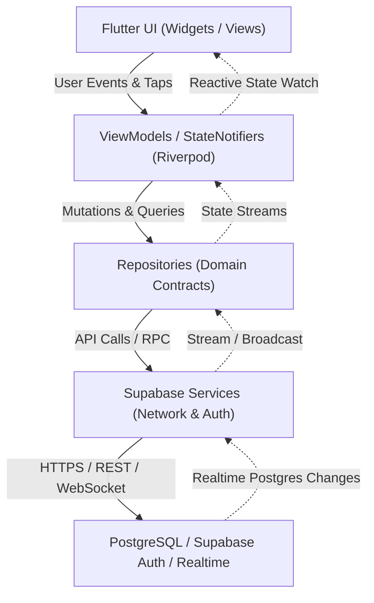
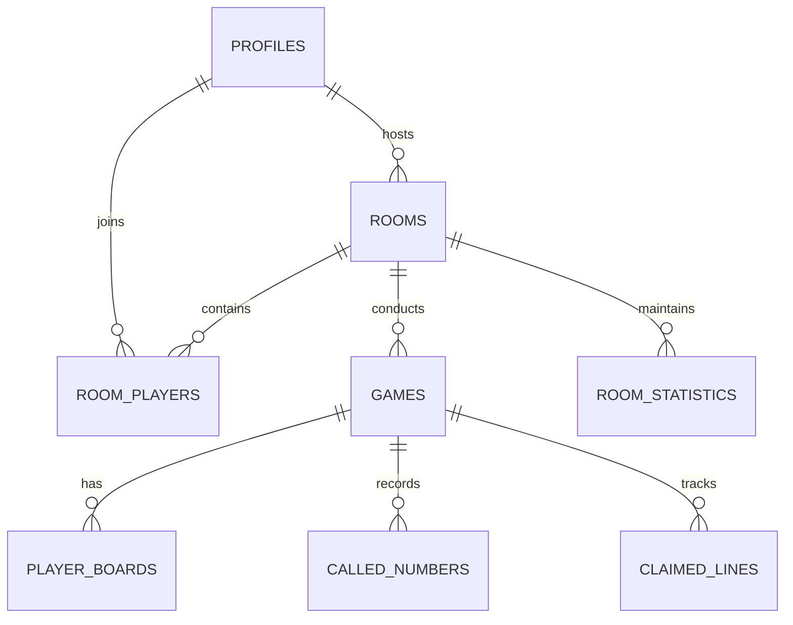

# Application & Backend Architecture – BINGO Mobile Game

## 1. Architectural Overview

BINGO follows a clean, reactive, **Feature-First Architecture** adhering strictly to the **View / ViewModel / Repository / Service** pattern.



---

## 2. Layer Responsibilities

### 2.1 View (Presentation Layer)
* Pure, declarative Flutter widgets.
* Responsible exclusively for rendering UI based on immutable state models and capturing user interactions.
* **Invariant**: No business logic, game calculations, database calls, or navigation decisions are embedded directly inside UI widgets.

### 2.2 ViewModel (Presentation Logic / State Management)
* Implemented using **Riverpod** (`StateNotifier` / `AsyncNotifier`).
* Handles UI-specific state transformations, form validation, error formatting, and user event dispatching.
* Exposes clean, immutable state objects to the View.

### 2.3 Repository (Domain & Data Orchestration)
* Defines clean abstract domain contracts (e.g. `AuthRepository`, `RoomRepository`, `GameRepository`).
* Orchestrates data from local caches, Supabase services, and offline state fallbacks.
* Maps backend DTOs to strongly-typed Dart domain entities.

### 2.4 Service (Infrastructure & Network Layer)
* Encapsulates low-level communication with external APIs:
  * `SupabaseAuthService` (Auth session management, token refresh)
  * `SupabaseDatabaseService` (PostgREST queries, RPC mutations)
  * `SupabaseRealtimeService` (Channel subscription, presence, postgres change streams)

---

## 3. Server-Authoritative Multiplayer Invariant

> [!CAUTION]
> **PostgreSQL is the single authoritative source of truth for all multiplayer gameplay.**
> Mobile clients are untrusted endpoints. The client app is an interface for presentation and intent submission only.

### Security Guarantees
The client application **never** decides:
1. Whose turn it is.
2. Whether a number is eligible to be called.
3. Whether a cell is marked.
4. Whether a line is complete.
5. Whether a line claim is legitimate.
6. Whether a player has achieved BINGO / Won the match.
7. Whether a room can start or close.

### Mutation Execution Model
All state transitions that affect match outcomes are processed using **PostgreSQL Functions (Stored Procedures / RPC)** executed in isolated database transactions:
* `rpc_call_number(p_game_id, p_player_id, p_number)`:
  - Validates active turn and player ownership.
  - Validates that `p_number` has not been previously called.
  - Inserts into `called_numbers`.
  - Advances turn sequence.
  - Emits Realtime broadcast.
* `rpc_claim_line(p_game_id, p_player_id, p_line_id)`:
  - Retrieves the player's secret board from `player_boards`.
  - Verifies that all 5 cells in `p_line_id` have been called.
  - Verifies that `p_line_id` has not already been claimed.
  - Increments player's claimed count.
  - Checks if claimed count $\ge 5$; if so, flags player as winner and updates room stats.

---

## 4. Proposed Database Schema & Entity Relationships



### 4.1 Profiles Table (`public.profiles`)
Represents registered players. Primary key matches `auth.users.id`.
```sql
CREATE TABLE public.profiles (
    id UUID PRIMARY KEY REFERENCES auth.users(id) ON DELETE CASCADE,
    display_name TEXT NOT NULL,
    email TEXT NOT NULL,
    avatar_id TEXT DEFAULT 'default_1',
    created_at TIMESTAMPTZ DEFAULT NOW(),
    updated_at TIMESTAMPTZ DEFAULT NOW()
);

-- Row Level Security
ALTER TABLE public.profiles ENABLE ROW LEVEL SECURITY;
CREATE POLICY "Public profiles are readable by everyone" ON public.profiles FOR SELECT USING (true);
CREATE POLICY "Users can update their own profile" ON public.profiles FOR UPDATE USING (auth.uid() = id);
```

### 4.2 Rooms Table (`public.rooms`)
Represents private multiplayer rooms.
```sql
CREATE TABLE public.rooms (
    id UUID PRIMARY KEY DEFAULT gen_random_uuid(),
    room_code VARCHAR(6) UNIQUE NOT NULL,
    host_id UUID NOT NULL REFERENCES public.profiles(id),
    name TEXT NOT NULL,
    max_players INT DEFAULT 4 CHECK (max_players BETWEEN 2 AND 4),
    prep_time_seconds INT DEFAULT 45,
    turn_time_seconds INT DEFAULT 20,
    status TEXT NOT NULL DEFAULT 'waiting', -- 'waiting', 'preparing', 'playing', 'finished'
    created_at TIMESTAMPTZ DEFAULT NOW()
);

ALTER TABLE public.rooms ENABLE ROW LEVEL SECURITY;
CREATE POLICY "Rooms viewable by authenticated users" ON public.rooms FOR SELECT USING (auth.role() = 'authenticated');
```

### 4.3 Room Players Table (`public.room_players`)
Tracks participants in a room.
```sql
CREATE TABLE public.room_players (
    id UUID PRIMARY KEY DEFAULT gen_random_uuid(),
    room_id UUID NOT NULL REFERENCES public.rooms(id) ON DELETE CASCADE,
    player_id UUID NOT NULL REFERENCES public.profiles(id),
    is_ready BOOLEAN DEFAULT false,
    joined_at TIMESTAMPTZ DEFAULT NOW(),
    UNIQUE (room_id, player_id)
);
```

### 4.4 Games / Rounds Table (`public.games`)
Each match round conducted inside a room.
```sql
CREATE TABLE public.games (
    id UUID PRIMARY KEY DEFAULT gen_random_uuid(),
    room_id UUID NOT NULL REFERENCES public.rooms(id) ON DELETE CASCADE,
    round_number INT DEFAULT 1,
    current_turn_player_id UUID REFERENCES public.profiles(id),
    preparation_deadline TIMESTAMPTZ,
    status TEXT NOT NULL DEFAULT 'preparing', -- 'preparing', 'active', 'completed', 'draw'
    winner_player_ids UUID[] DEFAULT ARRAY[]::UUID[],
    created_at TIMESTAMPTZ DEFAULT NOW(),
    completed_at TIMESTAMPTZ
);
```

### 4.5 Player Boards Table (`public.player_boards`)
Stores the secret 25-number matrix for each player.
```sql
CREATE TABLE public.player_boards (
    id UUID PRIMARY KEY DEFAULT gen_random_uuid(),
    game_id UUID NOT NULL REFERENCES public.games(id) ON DELETE CASCADE,
    player_id UUID NOT NULL REFERENCES public.profiles(id),
    matrix INT[] NOT NULL CHECK (array_length(matrix, 1) = 25),
    is_confirmed BOOLEAN DEFAULT false,
    created_at TIMESTAMPTZ DEFAULT NOW(),
    UNIQUE (game_id, player_id)
);

-- RLS: Player boards can ONLY be read by the owner or server functions
ALTER TABLE public.player_boards ENABLE ROW LEVEL SECURITY;
CREATE POLICY "Players can only view their own boards" ON public.player_boards
    FOR SELECT USING (auth.uid() = player_id);
```

### 4.6 Called Numbers Table (`public.called_numbers`)
Synchronized call sequence for a game.
```sql
CREATE TABLE public.called_numbers (
    id UUID PRIMARY KEY DEFAULT gen_random_uuid(),
    game_id UUID NOT NULL REFERENCES public.games(id) ON DELETE CASCADE,
    called_by_player_id UUID NOT NULL REFERENCES public.profiles(id),
    number INT NOT NULL CHECK (number BETWEEN 1 AND 25),
    call_index INT NOT NULL,
    called_at TIMESTAMPTZ DEFAULT NOW(),
    UNIQUE (game_id, number)
);
```

### 4.7 Claimed Lines Table (`public.claimed_lines`)
Records verified line strikes per player.
```sql
CREATE TABLE public.claimed_lines (
    id UUID PRIMARY KEY DEFAULT gen_random_uuid(),
    game_id UUID NOT NULL REFERENCES public.games(id) ON DELETE CASCADE,
    player_id UUID NOT NULL REFERENCES public.profiles(id),
    line_id TEXT NOT NULL, -- 'row_0' to 'row_4', 'col_0' to 'col_4', 'diag_main', 'diag_anti'
    claimed_at TIMESTAMPTZ DEFAULT NOW(),
    UNIQUE (game_id, player_id, line_id)
);
```

### 4.8 Room & Player Statistics Tables
* `public.room_statistics`: Session-scoped rankings and win streaks across rematches.
* `public.player_statistics`: Aggregate global career numbers (games played, wins, win rate, best streak).

---

## 5. Realtime Subscription Topology

Clients subscribe to targeted PostgreSQL Realtime channels based on active game context:
1. **Lobby Channel (`room:{roomId}`)**: Listens to changes in `room_players` (joins, leaves, ready toggles) and `rooms` (status transition to preparation).
2. **Game Channel (`game:{gameId}`)**: Listens to changes in `called_numbers` (new balls called), `games` (active turn player, match complete), and `claimed_lines` (opponent progress updates).
3. **Presence Channel (`presence:{roomId}`)**: Monitors live client connection drops and ping heartbeats.
